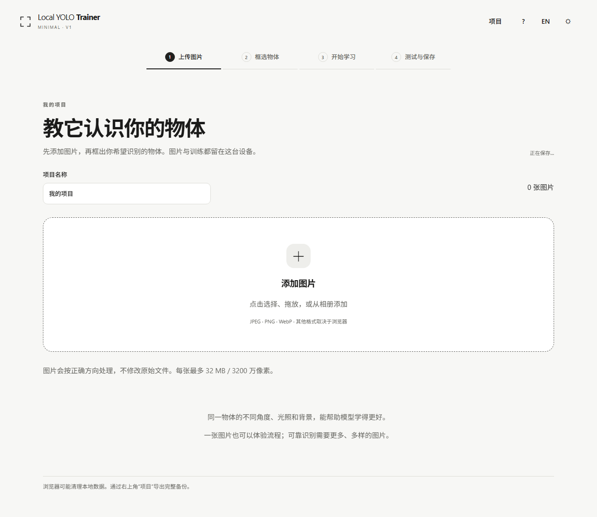
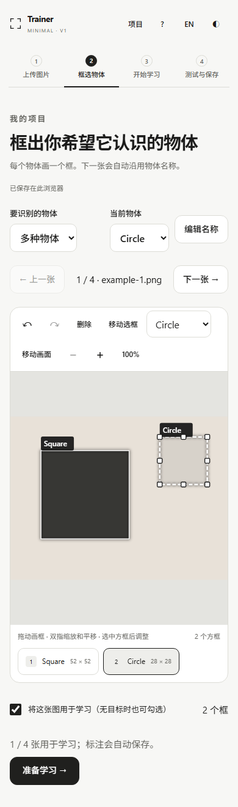

# Local YOLO Trainer

Teach a visual detector with your own pictures, entirely in your browser.

**V1.0 — browser-local object detection training.** [Open Trainer](https://unowhatpvp-alt.github.io/local-yolo-trainer/) · [Verification and limits](docs/TRAINING_VERIFICATION.md) · [Build and deployment status](https://github.com/unowhatpvp-alt/local-yolo-trainer/actions)

Pictures → Mark objects → Teach model → Test & save.

Local YOLO Trainer is an independent companion to the [Local YOLO inference tool](https://unowhatpvp-alt.github.io/local-yolo/). GitHub Pages serves the application and its model assets; training uses the visitor's own device. There is no training server, account, Python installation, or image upload service.

[中文说明](#中文说明) · [Model provenance](docs/MODEL_PROVENANCE.md) · [Architecture](docs/ENGINE_CONTRACT.md)

## What it trains

| Mode | Actual computation | Important limit |
| --- | --- | --- |
| Pretrained features, recommended | Frozen YOLO26n neck features plus a newly trained spatial detection head | This is **not full YOLO26 fine-tuning**. |
| From scratch | A small three-convolution detector; all its parameters start randomly and are trained | This is **not YOLO26 from scratch**. |
| Continue a checkpoint | The compatible model, Adam state, sample order, and random generator are restored | An inference ONNX is not a resumable training checkpoint. |

All modes predict boxes and classes. They are object detectors, rather than image classifiers. Input is currently fixed at 128 × 128 with aspect-preserving letterboxing. Two object centres can share one grid cell; unsupported collisions are rejected instead of silently dropping annotations. Small images and limited training data constrain accuracy. Test on genuinely new pictures before relying on a model.

CPU, WASM, WebGL, and WebGPU are selected only after a real forward/loss/gradient/parameter-update probe for the requested architecture. Backend availability differs by browser and mode. In particular, the WASM backend can lack convolution-gradient operations required by the from-scratch mode. A failed capability check is shown with its reason; API presence alone is not reported as verified acceleration.

## Use

1. Add several pictures with different backgrounds, angles, and lighting.
2. Name the objects once, then draw a box around every target. Confirm empty pictures explicitly to use them as negative examples.
3. Start learning. Advanced settings expose epochs, batch size, learning rate, augmentation, and compute backend.
4. Test a picture that was not used for training. Save a checkpoint to keep learning, or export an inference ONNX.

Annotations support moving, eight resize handles, category changes, undo/redo, keyboard input, zoom/pan, and touch gestures. The interface has Chinese/English and light/dark appearances. Desktop mobile-view emulation is not evidence of training on a physical phone; physical Android/iPhone/tablet qualification remains pending.

## Interface preview

These generated examples demonstrate the workflow and interface, not detection accuracy. **使用生成示例展示交互，不代表检测精度。** See the [UI verification record](docs/UI_VERIFICATION.md) for the tested candidate, 132 layout checks, real workflow evidence, and device limits.



<details>
<summary>Mobile annotation / 手机标注（desktop emulation / 桌面模拟）</summary>



</details>

## Save and recover

| File | Contains | Used for |
| --- | --- | --- |
| `.lymodel` | Trained parameters, class order, complete Adam state, training progress, and feature provenance | Continue compatible training; no source pictures included |
| `.onnx` | A standard ONNX detector with the learned parameters, boxes, and class scores | Inference; it does not contain resumable training state |
| `.lyproj` | Pictures, original-pixel annotations, classes, settings, and an optional checkpoint | Restore a complete project as a new project |
| Dataset `.zip` | Oriented pictures, normalized YOLO labels, train/validation folders, and `data.yaml` | Reuse the annotated dataset elsewhere |

Project data is saved in IndexedDB in the current browser profile and site origin. Browsers may clear it, and private browsing or storage quotas may prevent saving. A save is reported successful only after its transaction commits. Export project backups for important work. Imports validate structure, tensor shapes, payload hashes, class order, and model provenance; a backup does not overwrite an existing project.

Image orientation is corrected in the browser. JPEGs are re-encoded at the oriented original resolution; the user's files on disk are never modified. Duplicate pictures stay in one split, and unchecked pictures are excluded from training. Validation on a tiny dataset cannot establish broad accuracy.

## Development

Node.js 22.12+ or 24 and npm are required for development only.

```sh
npm ci
npm run dev
npm test
npm run build
npm run preview
```

The default base path is `/local-yolo-trainer/`. Set `TRAINER_BASE` when deploying at another static path. Navigation uses URL fragments, so refreshing a step does not require server-side routes. Model and WASM assets are served from the same origin and prepared during the build. HTTPS is required for WebGPU outside localhost. No cross-origin isolation headers are assumed.

The initial page keeps the training framework in a Worker and loads it only when needed. Images are processed sequentially with bounded gallery pages and thumbnails. Training preparation has an explicit memory budget; exceeding it preserves annotations and reports an error.

Browser regression tests use Playwright Chromium. Developer-only real-photograph fixtures are downloaded separately and are not redistributed with this repository. See the provenance document for source, hashes, split policy, and scope. Generated rectangle tests establish gradients, coordinates, checkpoint recovery, and export parity; they do not establish natural-image accuracy.

## Privacy and license

The application has no analytics or user-data upload endpoint. Frameworks and the frozen feature asset download from the deployed site. Pictures, annotations, and training are processed locally; exporting or sharing a file is a separate user action.

Code and the derived YOLO26n feature model are distributed under [AGPL-3.0](LICENSE). TensorFlow.js, ONNX Runtime and fflate notices are preserved under `third_party/` and included with the runtime build. Check their respective terms before redistributing modified products or model assets.

## 中文说明

这是面向普通用户的独立浏览器目标检测训练工具，与现有 Local YOLO 推理网站分开开发。操作流程是：**上传图片 → 框选物体 → 开始学习 → 用新图片测试 → 保存模型**。训练在访问者自己的设备上运行，GitHub Pages 只提供静态文件，开发者电脑无需开机。

默认方案使用冻结的 YOLO26n 深层空间特征，真实训练新的检测头；从零模式训练一个独立的小型卷积检测器。两者都不能称为完整 YOLO26 训练。兼容检查点能够恢复参数、Adam 优化器和训练进度，普通推理 ONNX 不能直接继续训练。

支持单类别、多类别、触摸标注、原图坐标、撤销重做、中英文和浅深色外观。图片、标注、配置和检查点保存在浏览器 IndexedDB 中；请通过“项目”定期导出完整备份。浏览器清理、隐私模式或空间不足可能影响保存，不能把本地存储当成永久备份。

桌面浏览器已验证的能力和限制见验收记录，线上构建与部署状态请查看 GitHub Actions。桌面模拟的手机布局和触摸操作，不等于真实手机训练通过。不能据此声称所有 YOLO26 模型、iPhone Safari 或移动端 GPU 已经支持。
